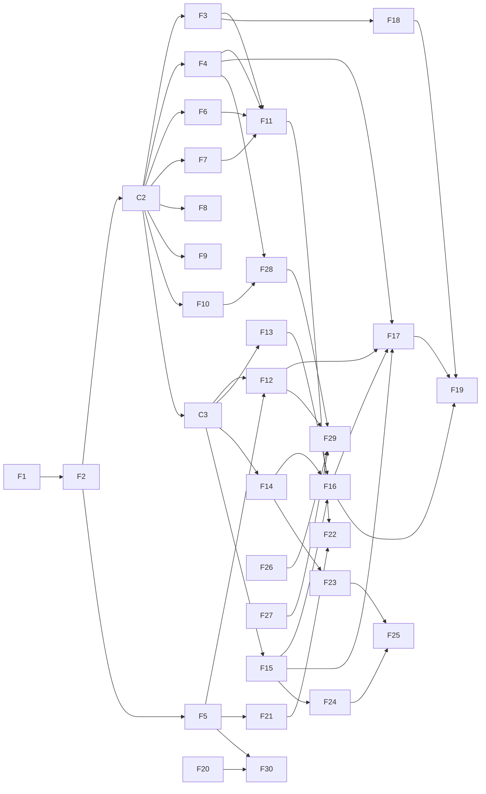

# Context-aware tagger — Feature plan

This plan splits the milestones in [implementation-plan.md](implementation-plan.md) (M1 to
M8) into small features that separate agents can build at the same time, maps their
dependencies, and orders them into waves. It does not authorize implementation: each
milestone starts only when the user asks for it (see `AGENTS.md`).

## Starting point

On `main`: the project scaffold (`src/contcheck/` with a `cli.main` entry point that prints
a greeting), the check tooling (`just check`, pre-commit, CI) and the design docs. No domain
code or ML dependencies exist yet.

The planned dependencies all support Python 3.14: resolving `torch`, `transformers`,
`datasets`, `sentence-transformers`, `spacy`, `errant`, `symspellpy`, `lemminflect`,
`onnxruntime` and `onnx` together for CPython 3.14 on Linux x86_64 succeeds with current
releases (checked 2026-10-24).

## How features stay independent

Parallel work fails on shared files, not on shared ideas. Five rules keep features apart:

1. **Contracts open each milestone.** From M2 on, a small contracts feature (C2 to C7)
   lands that milestone's value types, protocols, shared fakes and dependencies before
   anything else. After it, features depend on *protocols* and test against fakes. A
   "soft" dependency below needs only the protocol; a "hard" one needs the other feature's
   real implementation. M1 is small enough that its first feature (F1) plays this role.
   Contracts are written one milestone at a time, so later designs are not guessed before
   earlier code exists.
2. **One module per corruptor and corrector.** Corruptors register by kind
   (`corrupt/<kind>.py`), correctors likewise (`correct/<kind>.py`), so features that add
   kinds never edit the same file. The registries themselves are created by the
   milestone's contracts feature.
3. **CLI split by domain.** C2 moves `cli/main.py` to a root app plus one command module per
   domain (`cli/corrupt.py`, `cli/train.py`, ...). A feature adds its own command module;
   only the contracts feature edits the root app. CLI modules are the only composition
   roots: they construct the spaCy, Hugging Face, ONNX and HTTP adapters and pass them in.
4. **Fakes and dependencies have one owner.** Fakes shared across domains (`TextAnalyzer`,
   `Inflector`, `Dictionary`, `Annotator`, `Tokenizer`, `LLMClient`, a seeded `Rng`) go in
   `tests/conftest.py`, and only the milestone's contracts feature edits that file or
   `pyproject.toml` / `uv.lock`. Fakes used by one domain go in that domain's
   `tests/<type>/<domain>/conftest.py`.
5. **No network or model downloads in the default suite.** Unit tests use fakes and tiny
   models built from a config with random weights (for example a 2-layer `ElectraConfig`),
   never downloaded checkpoints. The spaCy model is a locked dev dependency installed by
   `uv sync`, so integration tests that need it run offline. Tests that need a downloaded
   Hugging Face model, Ollama or real datasets carry a `models`, `llm` or `datasets` pytest
   marker and are deselected by default; C3 adds the markers and a `just test-all` recipe.

## Domains

Code lives under `src/contcheck/`, one package per domain. Each keeps its models,
protocols and implementations in separate modules.

| Package | Holds | First feature |
| --- | --- | --- |
| `taxonomy` | `ErrorKind`, `Operation`, label map, BIO helpers, ERRANT code map | F1 |
| `corpus` | JSONL record schema, ingestion, document-level splits, merge, report | C2 |
| `analysis` | `TextAnalyzer` protocol (POS, lemmas, finite verbs), spaCy adapter, tense histogram, doc stats | C2 |
| `spelling` | `Dictionary` protocol, SymSpell adapter (lookup and suggestions) | C2 |
| `annotation` | `Annotator` protocol, ERRANT adapter mapping edits through `taxonomy` | C2 |
| `corrupt` | `Edit`, corruptor registry, one module per kind, applier, generation config | C2 |
| `llm_gen` | `LLMClient` protocol, Ollama adapter, prompts, relabeling, filters | C5 |
| `model` | Tokenizer alignment, windows, collator, `ContextTagger` | C3 |
| `training` | Train loop, metrics, evaluation, ONNX export | C3 |
| `features` | `Embedder` protocol, doc vector assembly, cache | C4 |
| `infer` | BIO decoding, window merge, thresholds, `check(text)` over ONNX Runtime | C3 (decode), C6 |
| `correct` | `Corrector` protocol, masked-LM scorer, per-kind correctors, routing | C7 |
| `cli` | `contcheck` commands; the only composition root | C2 |

`analysis`, `spelling` and `annotation` are not in the implementation plan's layout: they
are adapters several domains share (the corruptors, doc vector, inference and correctors
all use spaCy and SymSpell; M2, M3 and M5 all use ERRANT), so each gets one owner.

## Features

IDs are stable; use them in branch names and session titles.

### Wave 1: M1 taxonomy (`feat/m1-taxonomy`)

| ID | Feature | Domain | Hard deps | Scope |
| --- | --- | --- | --- | --- |
| F1 | Error kinds and labels | `taxonomy` | — | `ErrorKind` (19 kinds) and `Operation` as `StrEnum`, `LABELS` / `LABEL2ID` (39 labels), BIO helpers: spans to word labels, labels to spans with invalid-sequence repair, the "Missing tags the word after the gap" rule. Round-trip tests for every kind. No dependencies added |
| F2 | ERRANT code map | `taxonomy` | F1 | `errant_map.py`: every ERRANT code (`R:VERB:TENSE`, `M:DET`, `R:SPELL`, `R:ORTH`, ...) mapped to `(ErrorKind, Operation)` or listed as dropped (`OTHER` and anything without a clean mapping). Pure data plus a lookup; the code list is a constant, so no `errant` dependency yet. Test that every code is mapped or dropped. **Ends M1** |

### Wave 2: M2 contracts (`feat/m2-rule-data`, one agent)

| ID | Feature | Scope |
| --- | --- | --- |
| C2 | M2 contracts | Value types: `Edit` (frozen dataclass), `Record` (Pydantic, the JSONL format), `CorruptionContext` (words, tags, lemmas, tense histogram), `GenConfig` (Pydantic, `configs/gen.yaml`). Protocols: `Corruptor`, `TextAnalyzer`, `Inflector`, `Dictionary`, `Annotator`. Corruptor registry. Shared fakes and a seeded `Rng`. CLI split into a root app and per-domain command modules (`cyclopts`, as in git-manager). Dependencies: `pydantic`, `pyyaml`, `cyclopts`, `spacy`, `en-core-web-sm` (locked URL dev dependency), `lemminflect`, `symspellpy`, `errant`. `.gitignore` entries for `data/` |

### Wave 3: M2 rule-based data (parallel, each needs only C2)

| ID | Feature | Domain | Hard deps | Scope |
| --- | --- | --- | --- | --- |
| F3 | spaCy analyzer | `analysis` | C2 | `TextAnalyzer` over `en_core_web_sm`: tokens, Penn tags, lemmas, finite verbs; pure `tense_histogram` (VBD, VBP+VBZ, MD, other) and `doc_stats`. Integration test on real spaCy (offline) |
| F4 | SymSpell dictionary | `spelling` | C2 | `Dictionary` over `symspellpy`: membership, edit-distance-2 suggestions with frequencies, user words. Skips numbers, URLs, code and all-caps tokens. Integration test with the bundled frequency list |
| F5 | ERRANT annotator | `annotation` | C2, F2 | `Annotator`: run ERRANT on `(noisy, clean)`, map each edit through F2, return `Edit`s or `None` when any edit is unmapped. Spans in noisy-text word indices |
| F6 | Clean corpus ingestion | `corpus` | C2 | Read raw paragraph files, group 2–5 paragraphs into documents with `doc_id`, filter out paragraphs SymSpell flags heavily (`Dictionary` protocol), deterministic document-level train/val/test split by hashed `doc_id`. Sources are pluggable readers; the first reads plain text and JSONL |
| F7 | Corruption applier | `corrupt` | C2 | Sample 0–3 kinds per paragraph from `GenConfig` weights, retry another kind when a corruptor returns `None`, reject overlapping or adjacent edits, apply right to left, compute BIO labels on noisy words, tag Missing edits on the following word, match casing, re-attach punctuation, N variants per paragraph with derived seeds. Tested with fake corruptors |
| F8 | Orthographic corruptors | `corrupt` | C2 | Spelling (keyboard-adjacent, transposition, deletion, doubling, phonetic swaps; result must not be a dictionary word), Capitalization, Apostrophe, WordBoundary, Punctuation |
| F9 | Lexical corruptors | `corrupt` | C2 | RealWord (confusion sets as a data file), Determiner, Preposition, Conjunction (closed sets), ExtraWord, MissingWord, WordOrder |
| F10 | Morphological corruptors | `corrupt` | C2 | VerbTense (only in documents whose tense histogram is >80% one tense; keeps agreement), VerbForm, SubjectVerbAgreement, NounNumber, AdjectiveAdverb, PronounForm, plus the `Inflector` adapter over `lemminflect` |

The implementation plan puts Spelling, RealWord, VerbTense, SubjectVerbAgreement and
Determiner first. Each corruptor feature builds its first-priority kind first, so a
partial F8–F10 already gives M2's minimum set.

### Wave 4: M2 integration

| ID | Feature | Hard deps | Scope |
| --- | --- | --- | --- |
| F11 | Generation pipeline and quality report | F3, F4, F6, F7 (soft F5, F8–F10) | `contcheck corrupt`, `merge` and `report` commands: composition root wiring analyzer, dictionary and corruptors; dedupe, shuffle and keep document splits; per-kind counts and errors per paragraph against config targets. Quality checks as commands and tests: determinism (same seed, byte-identical output), round trip (reverting edits restores clean text), ERRANT label agreement per kind (≥ 90%, needs F5). **Ends M2** once the M2-priority corruptors are in |

### Wave 5: M3 contracts (`feat/m3-baseline`, one agent)

| ID | Feature | Scope |
| --- | --- | --- |
| C3 | M3 contracts | Value types: `Window` (token ids, labels, `doc_id`, offsets), `SpanError` (span, kind, op, probability), `TrainConfig`, `EvalResult`. Protocols: `Tokenizer` (pre-split words to subwords with word ids), `Tagger` (logits for windows). Dependencies: `transformers`, `datasets`, and `torch` as the `cpu`, `cuda` and `rocm` extras with their indices (see PyTorch builds); `just setup` takes the build. Device selection at the CLI root. Pytest markers `models`, `llm`, `datasets`, deselected by default, and `just test-all`. Tiny random-weight model fixture |

### Wave 6: M3 baseline tagger (parallel)

| ID | Feature | Domain | Hard deps | Scope |
| --- | --- | --- | --- | --- |
| F12 | Real eval sets | `corpus` | C3, F5 | Convert `.m2` files (BEA-2019 W&I+LOCNESS dev, FCE test, CoNLL-2014, JFLEG) and the GitHub Typo and Birkbeck corpora to `Record` JSONL through the annotator; a held-out clean set for false alarms. Readers tested on small fixture files; real data stays outside the repo |
| F13 | Alignment and windows | `model` | C3 | Label the first subword of each word, `-100` elsewhere; 256-token windows with stride 128 carrying `doc_id`; collator. Unit tests with a fake tokenizer, a `models` test with the real ELECTRA tokenizer |
| F14 | ContextTagger | `model` | C3 | Encoder plus fusion head with `use_doc`, `LayerNorm` on the doc vector, class weights (`O` = 0.2), loss with `ignore_index=-100`. Tested on a tiny random-weight ELECTRA from config: shapes, loss masking, doc path on and off |
| F15 | Decoding and metrics | `infer`, `training` | C3 | BIO to spans with repair (reusing F1 helpers), per-kind thresholds; span-level precision, recall and F0.5 per kind and overall, detection-only F0.5, confusion matrix, false alarms per 1,000 words. Pure functions, no `torch` |
| F16 | Training loop | `training` | F13, F14, F15 | `contcheck train`: separate learning rates for encoder and head, 6% warmup with linear decay, gradient clipping, early stop on val F0.5, checkpoints, seeded runs. A smoke test trains the tiny model for a few steps on fixture records |
| F17 | Evaluation command | `training` | F12, F15, F16, F4 | `contcheck evaluate`: per-kind table for every eval set, false-alarm rate, CPU latency p50/p95 per window, appended to a results log; a SymSpell-only baseline for comparison on spelling. **Ends M3** — the first useful milestone |

### Wave 7: M4 document context (`feat/m4-doc-context`)

C4 lands first (one agent): `DocVector`, the `Embedder` and `DocVectorStore` protocols,
the feature-code version constant, and `sentence-transformers`. Then:

| ID | Feature | Domain | Hard deps | Scope |
| --- | --- | --- | --- | --- |
| F18 | Doc vector | `features` | C4, F3 | `Embedder` over `all-MiniLM-L6-v2` (mean of paragraph embeddings), concatenation with tense histogram and doc stats into 392 floats, computed from the noisy text, `.npy` cache keyed by `doc_id` and feature version |
| F19 | Context training and ablations | `training` | F18, F16, F17 | Collator attaches doc vectors, `use_doc=True` runs, ablations (with and without the vector, embedding only vs tense only vs both), loader and report for the targeted tense test set. **Ends M4** |

### Wave 8: M5 LLM data (`feat/m5-llm-data`)

C5 lands first (one agent): the `LLMClient` protocol, writer profiles and prompt template
types, the `llm` section of `GenConfig`, and `httpx`. Then, in parallel:

| ID | Feature | Domain | Hard deps | Scope |
| --- | --- | --- | --- | --- |
| F20 | Ollama client | `llm_gen` | C5 | `LLMClient` over the Ollama HTTP API with timeouts, retries and parallel requests. Unit tests on `httpx.MockTransport`; an `llm` test against a running Ollama |
| F21 | Generation, relabeling and filters | `llm_gen` | C5, F5 | Prompt per paragraph and profile, `n` sampled 1–4, ERRANT relabel ignoring the LLM's own description, filters (1–6 edits, length ratio 0.9–1.1, character similarity ≥ 0.85, no unmapped types, no chatter), `contcheck generate` with resumable output |
| F22 | Data mix | `corpus` | F11, F21 | Rule/LLM mix ratio in `merge` (start 70/30), then the rule-only vs rule+LLM comparison on real eval data. **Ends M5** |

### Wave 9: M6 CPU inference (`feat/m6-cpu-inference`)

C6 lands first (one agent): the public `check(text) -> list[SpanError]` contract, the
`TaggerRuntime` protocol, threshold storage, and `onnx` / `onnxruntime`. Then, in
parallel:

| ID | Feature | Domain | Hard deps | Scope |
| --- | --- | --- | --- | --- |
| F23 | ONNX export | `training` | C6, F14 | `contcheck export`: `torch.onnx.export` with dynamic batch and sequence axes for tagger and embedder, dynamic int8 quantization, parity check (fp32 vs int8 logits, per-kind F0.5 drop ≤ 1 point) |
| F24 | Inference pipeline | `infer` | C6, F15 | SymSpell pre-pass, whole-document windowing, centre-most window merge, decode, per-kind thresholds tuned on val, SymSpell flags the model rates as confident `O` downgraded. `infer` must not import `torch`; a test enforces it |
| F25 | Latency and incremental checks | `infer` | F23, F24 | `contcheck bench` against the latency budget, re-tagging only windows that overlap an edit, doc-vector reuse. **Ends M6** |

### Wave 10: M7 corrections (`feat/m7-corrections`)

C7 lands first (one agent): `Suggestion`, the `Corrector` and `CandidateScorer`
protocols, routing by kind, and the corrector registry. Then, in parallel:

| ID | Feature | Domain | Hard deps | Scope |
| --- | --- | --- | --- | --- |
| F26 | Masked-LM scorer | `correct` | C7 | `CandidateScorer` scoring candidates in context with a small masked LM (DistilRoBERTa), exported to ONNX like F23 so corrections also run without `torch` |
| F27 | Rule correctors | `correct` | C7 | Deterministic fixes for Capitalization, Apostrophe, WordBoundary, Punctuation, ExtraWord |
| F28 | Candidate correctors | `correct` | C7, F4, F10 | Spelling (SymSpell distance ≤ 2, ranked by scorer and frequency), confusion-set kinds, inflection kinds (preferring the document's dominant tense), form tables for NounNumber, AdjectiveAdverb, PronounForm |
| F29 | Correction evaluation | `training` | F26, F27, F28, F12 | Top-1 suggestion accuracy per kind on real eval data. **Ends M7** |

### Wave 11: M8 structural fixes (`feat/m8-structural`)

| ID | Feature | Domain | Hard deps | Scope |
| --- | --- | --- | --- | --- |
| F30 | Constrained LLM corrector | `correct` | C7, F20, F5 | WordOrder, MissingWord, SentenceBoundary through the local LLM; reject any rewrite that ERRANT shows changing text outside the flagged span. **Ends M8** |

Not planned: the LightGBM reranker and GECToR-style edit tags from Phase 6. Revisit after
M7 has logged enough candidates.

## Dependency graph

Arrows are hard dependencies. Every feature also depends on its milestone's contracts.

**Critical path to the first useful milestone:** F1 → F2 → C2 → F7 → F11 → C3 → F13 / F14
→ F16 → F17. M3 also needs F12's real eval data, which depends on dataset access (see
decisions below).

## PyTorch builds

PyTorch is installed in one of three builds, chosen at setup. Each is an optional extra in
`pyproject.toml` whose `torch` comes from the matching PyTorch index, and the extras are
declared as conflicting so only one can be installed. One `uv.lock` covers all three.

| Extra | Build | Index | For |
| --- | --- | --- | --- |
| `cpu` (default) | `torch==2.14.1+cpu` | `https://download.pytorch.org/whl/cpu` | CI, laptops, inference work; macOS takes the PyPI build (CPU and MPS) |
| `cuda` | `torch==2.14.1+cu130` (CUDA 13.0) | `https://download.pytorch.org/whl/cu130` | NVIDIA GPUs on Linux |
| `rocm` | `torch==2.14.1+rocm7.2` | `https://download.pytorch.org/whl/rocm7.2` | AMD GPUs on Linux, including the RX 7900 series (`gfx1100`) |

- **Setup takes the build:** `just setup` installs `cpu`; `just setup cuda` or `just setup
  rocm` installs a GPU build (`uv sync --locked --extra <build>`). CI uses `cpu`.
- **Never install without an extra.** `sentence-transformers` depends on `torch`, so a plain
  `uv sync` on Linux pulls PyPI's default `torch`, which is a CUDA build. The `setup`
  recipe always passes one.
- **ROCm needs `triton-rocm` from the same index.** The ROCm `torch` depends on
  `triton-rocm` 3.8, which exists only on the PyTorch ROCm index (PyPI has an old
  pre-release), so the `rocm` extra lists it with that index as its source.
- **Indices are `explicit`**, so only `torch` and `triton-rocm` come from them; everything
  else resolves from PyPI.
- All three resolve for Python 3.14 (checked 2026-10-24 with a probe lock of
  `sentence-transformers` plus the three extras). The `rocm` build was installed and run on
  the RX 7900 XT: `torch 2.14.1+rocm7.2` (HIP 7.2) sees it as `cuda:0` with 20 GiB, and an
  fp32 matmul matches the CPU result. The `cuda` build has not been run.
- Code never branches on the build: device selection (`cuda` covers both NVIDIA and ROCm in
  PyTorch, else `cpu`) happens once at the CLI composition root and is passed in.
- **Pick the device explicitly.** ROCm also lists AMD integrated GPUs (on the dev machine,
  the Ryzen's `gfx1036` as `cuda:1`), which ROCm builds do not support. Device selection
  takes a `--device` option (default: the visible GPU with the most memory, else `cpu`)
  and logs the chosen device's name and architecture; `HIP_VISIBLE_DEVICES=0` also hides
  the integrated GPU.

## Running the plan

**Proof of concept first.** [poc-plan.md](poc-plan.md) builds a trimmed slice of F1, C2,
F3, F4, F6–F11, C3 and F13–F17 on a stack of three milestone branches to prove the
pipeline end to end. The milestones below then finish each feature's remaining scope.

**Branches** follow the `git-workflow` skill. Each milestone is one feature branch
(`feat/m1-taxonomy`, `feat/m2-rule-data`, ...), and each feature above is a task on it:
work branch `work/<milestone>/<id>-<slug>` in `.worktrees/<milestone>--<id>-<slug>`, landed
as one squashed commit. The contracts feature lands first. A milestone's branch goes to
`main` as one pull request when the user asks; the next milestone branches from `main`
after that merge.

**Sessions.** One agent session per feature, each in its own worktree, given its row from
this file plus the implementation-plan phase it names. Keep to about five concurrent
sessions. A feature starts when its hard dependencies have landed on the milestone branch.

**Done means** `just check` passes on the work branch after rebasing, the feature has unit
tests against fakes, and adapters (spaCy, SymSpell, ERRANT, Hugging Face, ONNX Runtime,
Ollama) have an integration test across the real boundary, marked if it needs a download.

**Code done vs milestone done.** A feature is done when its code and tests are. The
implementation plan's "Done when" gates (500k labeled paragraphs, per-kind F0.5 on real
data, latency targets) also need real runs on real data, which the user schedules
(training wants a GPU). Each milestone's final feature ships the command that produces the
gate's numbers; the milestone closes when those numbers are recorded.

### Schedule at a glance

| Wave | Milestone | Features (parallel within a wave) | Sessions |
| --- | --- | --- | --- |
| 1 | M1 | F1, then F2 | 1 |
| 2 | M2 | C2 | 1 |
| 3 | M2 | F3, F4, F5, F6, F7, F8, F9, F10 | 5 (F3 then F10; F4 then F8; F5 then F9) |
| 4 | M2 | F11 | 1 (starts when F3, F4, F6, F7 land) |
| 5 | M3 | C3 | 1 |
| 6 | M3 | F12, F13, F14, F15, then F16, then F17 | 4 |
| 7 | M4 | C4, then F18, then F19 | 1 |
| 8 | M5 | C5, then F20, F21, then F22 | 2 |
| 9 | M6 | C6, then F23, F24, then F25 | 2 |
| 10 | M7 | C7, then F26, F27, F28, then F29 | 3 |
| 11 | M8 | F30 | 1 |

## Decisions needed

The implementation plan's open questions, with the assumption this plan makes until the
user decides. None blocks M1 or M2.

| Decision | Blocks | Assumption |
| --- | --- | --- |
| Which language hosts the app | M6 (F24: can spaCy run at inference?) | Python, so F24 reuses the spaCy analyzer |
| English only, or other languages later | M3 (encoder choice) | English only; ELECTRA-small |
| Operation (M/U/R) as its own head in v1 | M3 (F14) | Metadata only, as the plan suggests |
| What latency counts as "fast" | M6 (F25) | On-demand checks under 1 s per document, with incremental re-tagging so as-you-type stays possible |
| Access to BEA-2019, FCE and the other eval sets | M3 (F12 real data) | The user obtains them (BEA-2019 needs a request form); licenses checked before any commercial use |
| Source of the clean corpus (50k–200k paragraphs) | M2 (F6 real data, F11 gate) | Openly licensed text across the plan's registers; readers stay source-agnostic |
| Where training runs | M3 (F16 real runs) | Locally on the user's AMD RX 7900 with the `rocm` build; everything else works on `cpu` |
