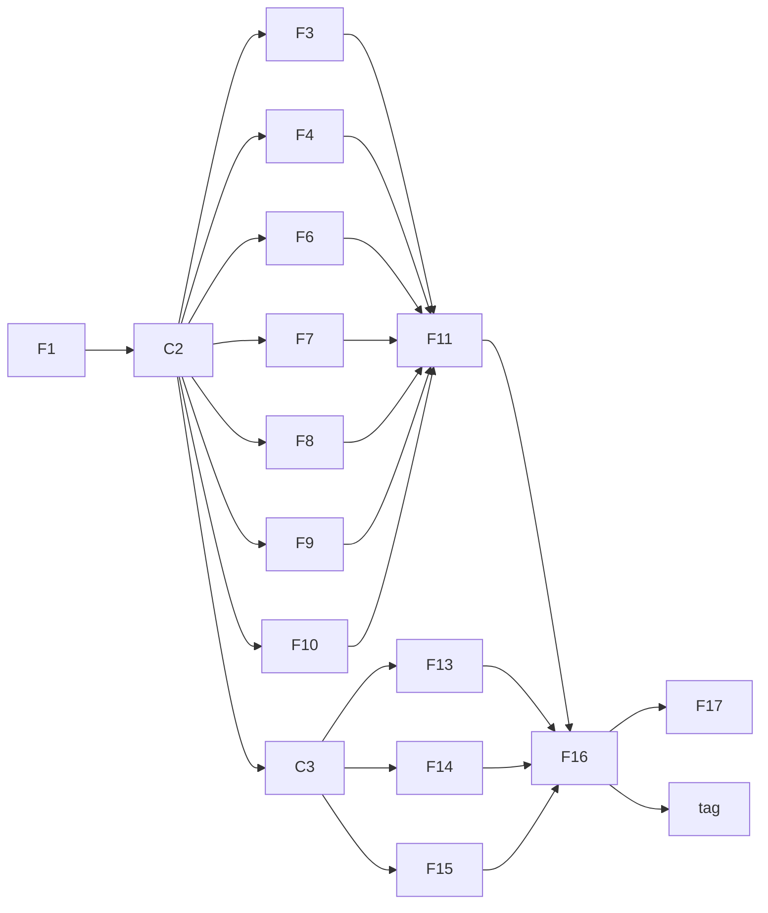

# Context-aware tagger — Proof-of-concept plan

The proof of concept trains the baseline tagger on synthetic errors and tags real text
from the command line:

```bash
just setup rocm
just cli corpus fetch --source wikipedia --limit 60000 --out data/raw/wiki.jsonl
just cli corrupt --config configs/gen.yaml --in data/raw --out data/synthetic/rule.jsonl
just cli merge data/synthetic/rule.jsonl --out-dir data/synthetic
just cli report data/synthetic/train.jsonl --config configs/gen.yaml
just cli train --config configs/train.yaml --device cuda:0
just cli tag "Yesterday I go to the store and buyed there apples."
```

It is a thin slice through M1 to M3 of [feature-plan.md](feature-plan.md), built first so
the end-to-end path is proven before the full milestones fill in. Like any design doc, it
does not authorize implementation; it starts when the user asks.

## Not throwaway

Every PoC feature is a full feature from the feature plan with a trimmed scope, built to
the same `AGENTS.md` rules (protocols, typed results, mirrored tests, `just check`). The
full feature later adds the trimmed parts to the same modules instead of rewriting them.
The one PoC-only piece is `contcheck tag`, which runs the PyTorch checkpoint directly; it
stays as a debugging command after M6's ONNX `check()` exists.

## Scope

| ID | PoC scope | Left for the full feature |
| --- | --- | --- |
| F1 | All of F1: `ErrorKind`, `Operation`, labels, BIO helpers | — |
| C2 | `Edit`, `Record`, `CorruptionContext`, `GenConfig`; `Corruptor`, `TextAnalyzer`, `Inflector`, `Dictionary` protocols; corruptor registry; shared fakes; CLI split. Dependencies: `pydantic`, `pyyaml`, `cyclopts`, `spacy`, `en-core-web-sm`, `lemminflect`, `symspellpy`, `datasets` | `Annotator` protocol and `errant` (with F5) |
| F3 | All of F3: spaCy analyzer, tense histogram, doc stats | — |
| F4 | Dictionary membership and suggestions | User words, token skipping rules |
| F6 | Plain-text and JSONL readers, `corpus fetch` streaming an English Wikipedia subset through `datasets`, document grouping, document-level split | SymSpell-based filtering, more sources |
| F7 | All of F7: the applier | — |
| F8 | Spelling | Capitalization, Apostrophe, WordBoundary, Punctuation |
| F9 | RealWord, Determiner | Preposition, Conjunction, ExtraWord, MissingWord, WordOrder |
| F10 | VerbTense, SubjectVerbAgreement, `Inflector` adapter | VerbForm, NounNumber, AdjectiveAdverb, PronounForm |
| F11 | `corrupt`, `merge` and `report` commands; determinism and round-trip checks | ERRANT label agreement (needs F5) |
| C3 | All of C3, including the `cpu` / `cuda` / `rocm` torch extras, `just setup <build>`, device selection and the test markers | — |
| F13 | All of F13: alignment, windows, collator | — |
| F14 | All of F14; trained with `use_doc=False` | Doc-vector training (F19) |
| F15 | All of F15: decoding and metrics | — |
| F16 | Training loop with early stopping and checkpoints, run on the RX 7900 XT | Resuming interrupted runs, hyperparameter sweeps |
| F17 | `evaluate` on the synthetic val split: per-kind F0.5, detection-only F0.5, false alarms per 1,000 words on clean val text, and the SymSpell-only baseline for spelling | Real eval sets (F12), latency |
| PoC | `contcheck tag`: load the checkpoint, window the text, decode, print each flagged span with kind and probability | Replaced for production use by M6's `check()` |

Out of the PoC: F2 and F5 (ERRANT), F12 (real eval data), and M4 to M8.

## Order



C3 only edits dependencies, fixtures and markers, so it runs right after C2, next to the
data features. The model features (F13, F14, F15) then build alongside the data pipeline.

| Step | Features (parallel within a step) | Sessions |
| --- | --- | --- |
| 1 | F1 | 1 |
| 2 | C2 | 1 |
| 3 | C3, then F13, F14, F15; and F3, F4, F6, F7, F8, F9, F10 | 5 |
| 4 | F11 | 1 |
| 5 | Generate data, then F16 and a training run | 1, plus compute |
| 6 | F17 and `tag` | 2 |

**Critical path:** F1 → C2 → F7 → F11 → data generation → F16 → training run → F17 /
`tag`.

## Running it

- **Branches:** one branch per milestone slice, stacked so each can be reviewed on its
  own: `feat/poc-m1-taxonomy` (F1) on `main`, `feat/poc-m2-rule-data` (C2, F3, F4,
  F6–F11) on it, and `feat/poc-m3-baseline` (C3, F13–F17, `tag`) on top. Each feature
  lands as one commit on its milestone branch; a change to a lower branch reaches the
  ones above it by merging it up, not by rebasing. Every branch is one pull request in
  the stack, merged bottom up after review. (This replaces the single `feat/poc-tagger`
  branch first planned, so review comes in milestone-sized pieces.)
- **Afterwards:** M1 to M3 continue from `main` with the remaining scope in the right-hand
  column, plus F2, F5 and F12.
- **Data and compute:** about 60,000 Wikipedia paragraphs grouped into documents, two
  corrupted variants each, gives roughly 120,000 training paragraphs. Generation runs on CPU
  (spaCy), roughly 15–30 minutes. Training ELECTRA-small for 3 epochs on the RX 7900 XT is
  estimated at 30–60 minutes. Data stays in `data/`, outside git.
- **Estimate:** about a day to a day and a half of agent sessions with up to five in
  parallel, plus 1–2 hours of compute. This is a planning estimate, not a measurement.

## Done when

- `just check` passes on every branch of the stack.
- `contcheck evaluate` reports per-kind F0.5 for all five PoC kinds on the synthetic val
  split, and the tagger beats the SymSpell-only baseline on Spelling.
- `contcheck tag` flags errors in a handful of hand-written sentences, one per PoC kind,
  and stays quiet on their corrected versions.

Synthetic scores overstate real-world quality (implementation plan, Phase 4). The PoC
proves the pipeline works end to end; M3's evaluation on real human errors judges the
model.

## Decisions

| Decision | Assumption |
| --- | --- |
| Clean corpus for the PoC | English Wikipedia (`wikimedia/wikipedia`, CC BY-SA 4.0) through `datasets`; public-domain fiction can be added later for past-tense narration |
| Hardware | Training on the RX 7900 XT with the `rocm` build; everything else on CPU |
