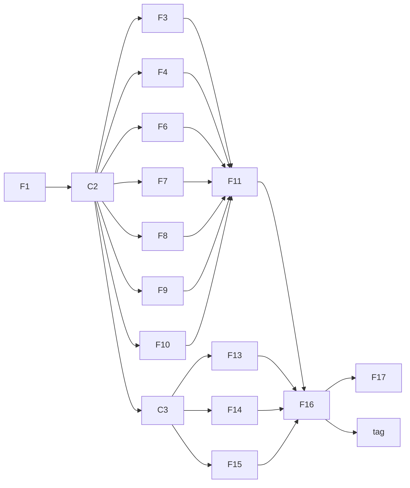

# Context-aware tagger — Proof-of-concept plan

The proof of concept trains the baseline tagger on synthetic errors and tags real text
from the command line:

```bash
just setup rocm
just cli corpus fetch --source wikipedia --limit 60000 --out data/raw/wiki.jsonl
just cli corrupt --config configs/gen.yaml --in data/raw --out data/synthetic/rule.jsonl
just cli merge data/synthetic/rule.jsonl --out-dir data/synthetic
just cli report data/synthetic/train.jsonl --config configs/gen.yaml
just cli train --config configs/train.yaml --device cuda:0
just cli tag "Yesterday I go to the store and buyed there apples."
```

It is a thin slice through M1 to M3 of [feature-plan.md](feature-plan.md), built first so
the end-to-end path is proven before the full milestones fill in. Like any design doc, it
does not authorize implementation; it starts when the user asks.

## Not throwaway

Every PoC feature is a full feature from the feature plan with a trimmed scope, built to
the same `AGENTS.md` rules (protocols, typed results, mirrored tests, `just check`). The
full feature later adds the trimmed parts to the same modules instead of rewriting them.
The one PoC-only piece is `contcheck tag`, which runs the PyTorch checkpoint directly; it
stays as a debugging command after M6's ONNX `check()` exists.

## Scope

| ID | PoC scope | Left for the full feature |
| --- | --- | --- |
| F1 | All of F1: `ErrorKind`, `Operation`, labels, BIO helpers | — |
| C2 | `Edit`, `Record`, `CorruptionContext`, `GenConfig`; `Corruptor`, `TextAnalyzer`, `Inflector`, `Dictionary` protocols; corruptor registry; shared fakes; CLI split. Dependencies: `pydantic`, `pyyaml`, `cyclopts`, `spacy`, `en-core-web-sm`, `lemminflect`, `symspellpy`, `datasets` | `Annotator` protocol and `errant` (with F5) |
| F3 | All of F3: spaCy analyzer, tense histogram, doc stats | — |
| F4 | Dictionary membership and suggestions | User words, token skipping rules |
| F6 | Plain-text and JSONL readers, `corpus fetch` streaming English Wikipedia and the sources in [Corpus sources](#corpus-sources-2026-10-24) through `datasets`, the cleanliness filter, document grouping, document-level split | Tuning the mix on real eval data |
| F7 | All of F7: the applier | — |
| F8 | Spelling | Capitalization, Apostrophe, WordBoundary, Punctuation |
| F9 | RealWord, Determiner | Preposition, Conjunction, ExtraWord, MissingWord, WordOrder |
| F10 | VerbTense, SubjectVerbAgreement, `Inflector` adapter | VerbForm, NounNumber, AdjectiveAdverb, PronounForm |
| F11 | `corrupt`, `merge` and `report` commands; determinism and round-trip checks | ERRANT label agreement (needs F5) |
| C3 | All of C3, including the `cpu` / `cuda` / `rocm` torch extras, `just setup <build>`, device selection and the test markers | — |
| F13 | All of F13: alignment, windows, collator | — |
| F14 | All of F14; trained with `use_doc=False` | Doc-vector training (F19) |
| F15 | All of F15: decoding and metrics | — |
| F16 | Training loop with early stopping and checkpoints, run on the RX 7900 XT | Resuming interrupted runs, hyperparameter sweeps |
| F17 | `evaluate` on the synthetic val split: per-kind F0.5, detection-only F0.5, false alarms per 1,000 words on clean val text, and the SymSpell-only baseline for spelling | Real eval sets (F12), latency |
| PoC | `contcheck tag`: load the checkpoint, window the text, decode, print each flagged span with kind and probability | Replaced for production use by M6's `check()` |

Out of the PoC: F2 and F5 (ERRANT), F12 (real eval data), and M4 to M8.

## Order



C3 only edits dependencies, fixtures and markers, so it runs right after C2, next to the
data features. The model features (F13, F14, F15) then build alongside the data pipeline.

| Step | Features (parallel within a step) | Sessions |
| --- | --- | --- |
| 1 | F1 | 1 |
| 2 | C2 | 1 |
| 3 | C3, then F13, F14, F15; and F3, F4, F6, F7, F8, F9, F10 | 5 |
| 4 | F11 | 1 |
| 5 | Generate data, then F16 and a training run | 1, plus compute |
| 6 | F17 and `tag` | 2 |

**Critical path:** F1 → C2 → F7 → F11 → data generation → F16 → training run → F17 /
`tag`.

## Running it

- **Branches:** one branch per milestone slice, stacked with `gh stack` so each can be
  reviewed on its own: `feat/poc-m1-taxonomy` (F1) on `main`, `feat/poc-m2-rule-data` (C2,
  F3, F4, F6–F11) on it, and `feat/poc-m3-baseline` (C3, F13–F17, `tag`) on top. Each
  feature lands as one commit on its milestone branch. Every branch is one pull request in
  the stack, merged bottom up after review. (This replaces the single `feat/poc-tagger`
  branch first planned, so review comes in milestone-sized pieces.)
- **Afterwards:** M1 to M3 continue from `main` with the remaining scope in the right-hand
  column, plus F2, F5 and F12.
- **Data and compute:** about 60,000 Wikipedia paragraphs grouped into documents, two
  corrupted variants each, gives roughly 120,000 training paragraphs. Generation runs on CPU
  (spaCy), roughly 15–30 minutes. Training ELECTRA-small for 3 epochs on the RX 7900 XT is
  estimated at 30–60 minutes. Data stays in `data/`, outside git.
- **Estimate:** about a day to a day and a half of agent sessions with up to five in
  parallel, plus 1–2 hours of compute. This is a planning estimate, not a measurement.

## Done when

- `just check` passes on every branch of the stack.
- `contcheck evaluate` reports per-kind F0.5 for all five PoC kinds on the synthetic val
  split, and the tagger beats the SymSpell-only baseline on Spelling.
- `contcheck tag` flags errors in a handful of hand-written sentences, one per PoC kind,
  and stays quiet on their corrected versions.

Synthetic scores overstate real-world quality (implementation plan, Phase 4). The PoC
proves the pipeline works end to end; M3's evaluation on real human errors judges the
model.

## First run (2026-10-24)

Measured on the dev machine with `configs/gen.yaml` and `configs/train.yaml` as committed.

- **Data:** 60,000 Wikipedia paragraphs from 10,222 articles; `corrupt` wrote 120,000
  records in 3.5 minutes on CPU; after `merge`, 106,291 train, 5,829 val and 6,098 test
  records, with no round-trip failures.
- **Training:** 106,968 windows on the RX 7900 XT with bfloat16 autocast. Val F0.5 peaked
  after epoch 1 (0.829) and fell after epoch 2 (0.821), so early stopping kept epoch 1. The
  whole run, two epochs with validation after each, took 5 minutes 20 seconds.
- **Synthetic val, span-level F0.5:**

  | Kind | Tagger | SymSpell only |
  | --- | --- | --- |
  | Spelling | 0.884 | 0.453 |
  | RealWord | 0.960 | — |
  | SubjectVerbAgreement | 0.881 | — |
  | VerbTense | 0.740 | — |
  | Determiner | 0.644 | — |
  | Overall | 0.829 | 0.377 |

  Detection-only F0.5 was 0.831, and the tagger made 4.4 false alarms per 1,000 clean words
  (SymSpell: 7.7).
- **Hand-written sentences:** `tag` flagged the error in one sentence per kind and in the
  example above (`go`, `buyed`, `there`), and flagged nothing in any corrected version. It
  also made one extra flag, Determiner at 0.53 on a correct word in the VerbTense sentence.

## Second run: realistic misspellings (2026-10-24)

The first model missed plain misspellings such as "libary" and "tomorow". Probing showed
two causes. Real misspellings follow sound and word structure and split into
normal-looking subwords (`occur ##ed`), while the corruptor's keyboard slips split into
junk. And because errors were never on neighbouring words, adjacent typos suppressed each
other. The Spelling corruptor gained realistic patterns, `adjacent_share: 0.1` put some
errors side by side, and `evaluate` gained a check that swaps 96 common real misspellings
into val text (1,132 probes, never next to a labeled error).

Both models on the first run's val set (same text):

| Measure | First run | Second run |
| --- | --- | --- |
| Overall span F0.5 | 0.829 | 0.815 |
| Spelling F0.5 | 0.884 | 0.879 |
| False alarms per 1,000 clean words | 4.42 | 5.06 |
| Real misspellings flagged, in val text | 0.623 | 0.681 |
| Real misspellings flagged, one fixed sentence | 0.34 | 0.32 |
| Typo caught when the next word also has one | 0.917 | 0.936 |
| That neighbouring typo caught | 0.827 | 0.858 |

The SymSpell baseline flags every probe, because each listed misspelling is a non-word
for it.

**Reading:** the patterns helped only a little (+6 points in context, nothing in a
neutral sentence), and they cost some precision. The tagger still misses "libary" and
"tomorow" in "Their going too the libary tomorow and he dont like it." The model has no
dictionary, so it cannot tell a plausible misspelling from a rare correct word.

**Decision:** non-word misspellings belong to the deterministic SymSpell pre-pass
(implementation plan, Phase 5a step 1), not the tagger. The patterns are reverted;
adjacent errors stay. The tagger's job is errors made of real words, the ones a
dictionary cannot see. Next: a held-out confusion check to test whether the model
generalizes beyond the pairs it trained on, then broader real-word error generation
and more registers than Wikipedia. M6 still needs a rule for combining SymSpell flags
with the tagger. Dropping flags the model rates as confident `O` would discard real
misspellings like the ones above, so that rule should be revisited.
The first run's model and data are kept locally as `runs/baseline-v1` and
`data/synthetic-v1`.

## Corpus sources (2026-10-24)

The tagger's job is now errors made of real words, which depend on register, and
Wikipedia has almost no first person, dialogue, narration, instructions or informal text.
`corpus fetch --source <name>` streams each source below; `corrupt --in data/raw` reads
every JSONL file in the directory, so each source's `--limit` sets the mix.

| Source (`--source`) | Hugging Face dataset | License | Streams | Notes |
| --- | --- | --- | --- | --- |
| `wikipedia` | [`wikimedia/wikipedia`](https://huggingface.co/datasets/wikimedia/wikipedia) `20231101.en` | CC BY-SA 3.0 / GFDL | yes | Unchanged |
| `simple-wikipedia` (optional) | [`wikimedia/wikipedia`](https://huggingface.co/datasets/wikimedia/wikipedia) `20231101.simple` | CC BY-SA 3.0 / GFDL | yes | Short plain sentences; not in the mix by default |
| `gutenberg` | [`sedthh/gutenberg_english`](https://huggingface.co/datasets/sedthh/gutenberg_english) | Books public domain in the US; dataset card MIT | yes (37 parquet shards, 10.7 GB) | 48,284 books with catalogue metadata (author birth/death years, subjects, bookshelves) and the license header already removed. No publication date: kept books have every main author born 1870 or later and a fiction subject or bookshelf, not drama or poetry (about 1 in 8 books) |
| `fineweb-edu` | [`HuggingFaceFW/fineweb-edu`](https://huggingface.co/datasets/HuggingFaceFW/fineweb-edu) `sample-10BT` | ODC-By 1.0 (plus Common Crawl terms) | yes | One paragraph per line; already filtered to educational score ≥ 3 |
| `wikinews` | [`Fumika/Wikinews-multilingual`](https://huggingface.co/datasets/Fumika/Wikinews-multilingual) | CC BY 2.5 | yes (one 45 MB JSONL) | 5,240 English articles with paragraphs as clean lists; only `lang == "en"` rows are used |
| `wikibooks`, `wikivoyage` | [`common-pile/wikimedia`](https://huggingface.co/datasets/common-pile/wikimedia) (`*_wikibooks.com.jsonl.gz`, `*_wikivoyage.com.jsonl.gz`) | CC BY-SA 4.0 per row | yes | Main namespace only. The wikitext conversion drops links and templates and leaves gaps (`the  of Brazil,,`); lines with such gaps are dropped |
| `stackexchange` | [`HuggingFaceH4/stack-exchange-preferences`](https://huggingface.co/datasets/HuggingFaceH4/stack-exchange-preferences), one `data/<site>.stackexchange.com` directory per site | CC BY-SA 4.0 | yes | Answers as HTML with `pm_score = round(log2(1 + upvotes))`, +1 if accepted. Answers with `pm_score ≥ 4` (about 10 upvotes) from 25 prose-heavy sites, taken site by site; `english` and `ell` are left out because they quote wrong sentences on purpose |

Skipped: the Common Pile Wikinews files (the same lossy conversion drops most link text
in news, for example "the of the People's Republic of China had lunch today with the of
Brazil,,"), [`manu/project_gutenberg`](https://huggingface.co/datasets/manu/project_gutenberg)
(raw text with license headers but no catalogue metadata, so no date or genre filter
without a separate catalogue download), [`deepmind/pg19`](https://huggingface.co/datasets/deepmind/pg19)
(pre-1919 books only, and a loading script the viewer cannot run),
[`common-pile/stackexchange`](https://huggingface.co/datasets/common-pile/stackexchange)
(no vote scores, and questions, answers and comments are joined into one text) and
[`flax-sentence-embeddings/stackexchange_titlebody_best_voted_answer_jsonl`](https://huggingface.co/datasets/flax-sentence-embeddings/stackexchange_titlebody_best_voted_answer_jsonl)
(CC BY-NC-SA).

**Cleanup per source.** Gutenberg: in this dataset a single line break ends a paragraph and
a doubled one is a hard wrap, so wraps are joined; Gutenberg start/end markers, chapter and
part headings, page and footnote markers (`[159]`, `[Illustration: ...]`) and `_emphasis_`
underscores are removed, and the first 10% of each book (contents, preface) is skipped.
Stack Exchange: only top-level `<p>` text is kept; code, quotes, lists, headings and tables
are dropped, and so is any paragraph with inline code, an image or a line break.
FineWeb-Edu, Wikinews, Wikibooks and Wikivoyage keep their paragraph structure, one line
per paragraph, so a heading such as "Understand" never sticks to the paragraph below it.

**Cleanliness filter (F6).** After the existing shape filter (20–200 words, ends like a
sentence), every source passes `CleanlinessFilter` on the injected `Dictionary`: it drops
paragraphs with list syntax, markup (HTML tags, wiki braces, URLs, entities, `|`, `\`,
`*`, underscores), more than 25% words in capitals, a sentence over 70 words, or more than
3% unknown words among lowercase alphabetic words of three or more letters. The bundled
SymSpell list is British-leaning, so an American spelling counts as known when its British
form is (neighborhood, theater, traveled, aluminum). `--max-non-word-share` and
`--max-sentence-words` change the thresholds, and `fetch` prints how many paragraphs each
check dropped. Share of shape-filtered paragraphs each source loses, on a sample of about
600 paragraphs per source (seed 13):

| Source | Screened | Rejected | Non-words | List | Markup | Other |
| --- | --- | --- | --- | --- | --- | --- |
| wikipedia | 645 | 15.8% | 91 | 0 | 3 | 8 |
| simple-wikipedia | 591 | 9.3% | 52 | 1 | 1 | 1 |
| gutenberg | 658 | 19.9% | 123 | 0 | 1 | 7 |
| fineweb-edu | 644 | 15.8% | 65 | 26 | 9 | 2 |
| wikinews | 553 | 4.3% | 21 | 0 | 1 | 2 |
| wikivoyage | 862 | 34.9% | 45 | 254 | 0 | 2 |
| wikibooks | 1,183 | 49.5% | 151 | 359 | 70 | 5 |
| stackexchange | 585 | 9.2% | 35 | 5 | 9 | 5 |

The non-word check removes what it should: eye dialect in Gutenberg ("knowd", "nawthin",
"gittin"), non-English passages in Wikibooks and Wikivoyage, and real typos ("tryed",
"sucide", "wierd"). It also drops some correct technical prose with rare words
("phenethylamine", "coagulopathy"). Wikivoyage and Wikibooks lose most to list items
(`* ...` listings).

**Spot check** (20 kept paragraphs per source). Wikinews, Gutenberg and Wikipedia read
clean. Real-word errors already in the source get through, as expected, most often in
Stack Exchange ("before resulting to", "pursue you Ph.D."), Wikibooks ("Larger organisms
has more cells compare to", "postion") and Wikivoyage ("Kingston is also to the longest").
Wikibooks still has a few dropped-link gaps the gap check cannot see ("It also has a, the
viceroy"). FineWeb-Edu has occasional lost dashes ("fresh air-and"). Hence the smaller
share for Wikibooks below.

**Fetch commands for the agreed mix** (100,000 paragraphs; scale the limits together):

```bash
just cli corpus fetch --source wikipedia --limit 35000 --out data/raw/wikipedia.jsonl
just cli corpus fetch --source gutenberg --limit 25000 --per-article 25 --out data/raw/gutenberg.jsonl
just cli corpus fetch --source fineweb-edu --limit 20000 --out data/raw/fineweb-edu.jsonl
just cli corpus fetch --source wikinews --limit 4000 --out data/raw/wikinews.jsonl
just cli corpus fetch --source wikivoyage --limit 4000 --out data/raw/wikivoyage.jsonl
just cli corpus fetch --source wikibooks --limit 2000 --out data/raw/wikibooks.jsonl
just cli corpus fetch --source stackexchange --limit 10000 --out data/raw/stackexchange.jsonl
```

`--per-article 25` takes 1,000 books instead of 2,500 for Gutenberg, which streams about
8,000 books (around 2 GB) instead of 20,000. The PoC's `data/raw/wiki.jsonl` predates the
filter; remove it before `corrupt --in data/raw`, or it is read as well.

## Decisions

| Decision | Assumption |
| --- | --- |
| Clean corpus for the PoC | First run: English Wikipedia (`wikimedia/wikipedia`, CC BY-SA 4.0) through `datasets`. From the real-word runs on: Wikipedia 35%, Gutenberg fiction 25%, FineWeb-Edu 20%, Wikinews/Wikivoyage/Wikibooks 10%, Stack Exchange 10% (see [Corpus sources](#corpus-sources-2026-10-24)); BookCorpus, CC-News, OpenSubtitles and raw Reddit, email or forum text are avoided as clean text |
| Hardware | Training on the RX 7900 XT with the `rocm` build; everything else on CPU |
